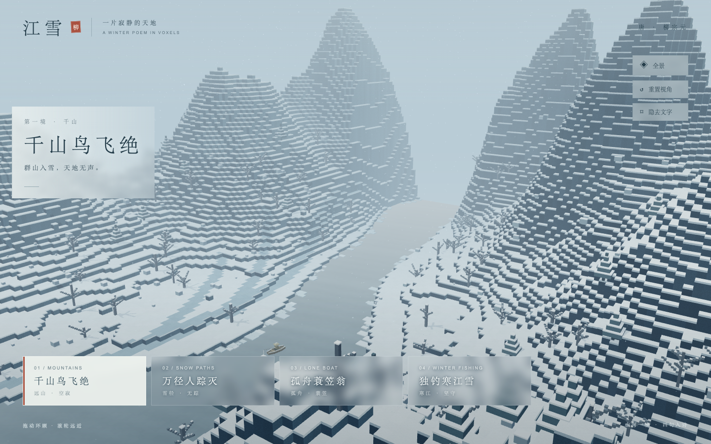
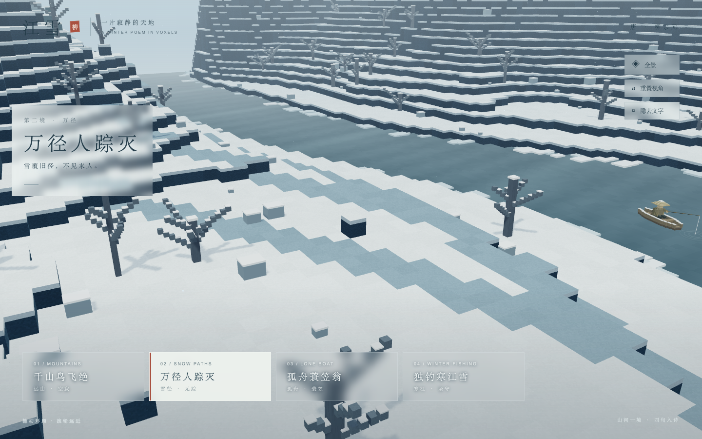
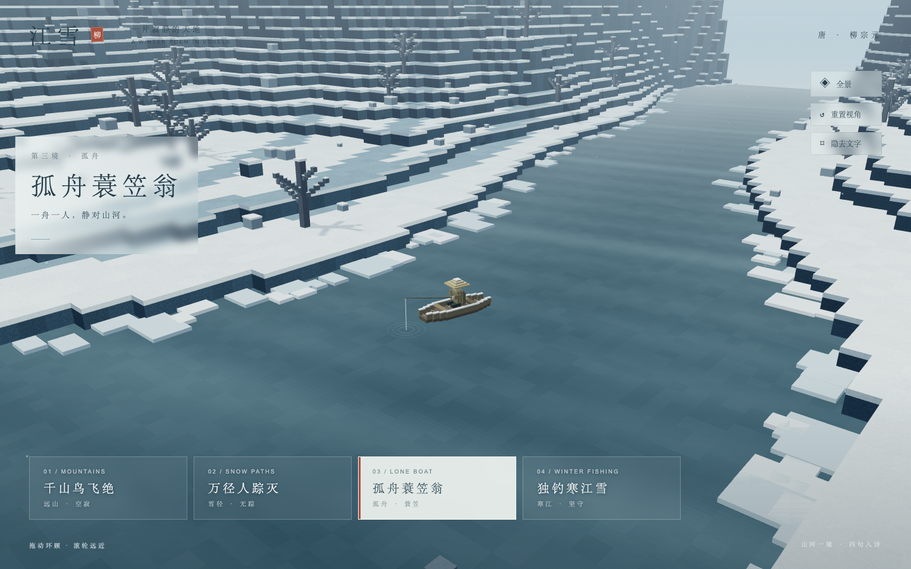
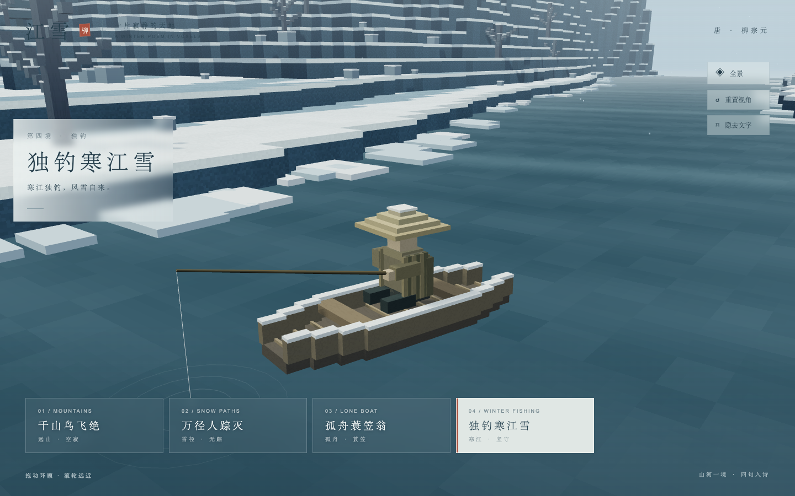
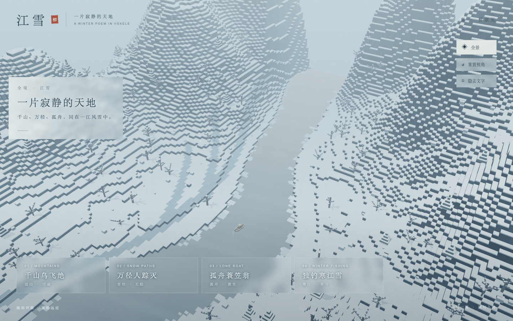

# 江雪 · 一片寂静的天地

把柳宗元的《江雪》化作一片可游览的 3D 方块雪山河谷。循着四句诗，从群山与无人雪径，走近寒江中的孤舟与蓑笠翁。



## 四句诗，同一片天地

| 诗句       | 景观                                     |
| ---------- | ---------------------------------------- |
| 千山鸟飞绝 | 层叠雪山、空旷天空与远处薄雾             |
| 万径人踪灭 | 河岸上分岔的覆雪小径、枯树和山石         |
| 孤舟蓑笠翁 | 广阔江面中的一叶木舟与一位蓑笠渔翁       |
| 独钓寒江雪 | 靠近同一叶舟，观察斗笠、蓑衣、钓线和水纹 |

所有景物共享一个世界坐标、地形、河流、天气与光照。选择诗句时，镜头在这个世界中连续移动。灰蓝与雪白的冷色画面、像素纹理和轻缓落雪，共同表现寂静与独处。






## 本地运行

需要 Node.js 22 或更新版本，以及 pnpm。依赖版本已固定，安装时会运行 Vite 所需的 esbuild 安装脚本。

```bash
pnpm install
pnpm dev
```

打开终端显示的本地地址。构建和查看生产版本：

```bash
pnpm build
pnpm preview --port 4173
```

生产预览地址为 `http://127.0.0.1:4173/river-snow/`。

## GitHub Pages 部署

部署成功后可访问：<https://echo-dm.github.io/river-snow/>。

首次部署时，在 GitHub 仓库的 **Settings → Pages → Build and deployment → Source** 中选择 **GitHub Actions**，然后将配置推送到 `main`。之后每次推送到 `main` 都会自动构建并部署；也可在 **Actions → Deploy to GitHub Pages → Run workflow** 中选择 `main` 手动触发。

工作流使用 Node.js 24 和 `package.json` 指定的 pnpm 版本，通过 `pnpm install --frozen-lockfile` 安装依赖，再执行 `pnpm build` 并发布 `dist/`。部署状态和实际访问地址可在 Actions 运行记录中查看。

Vite 的资源基础路径已设置为 `/river-snow/`；如果仓库改名或改用自定义域名，需要相应调整 `vite.config.ts` 中的 `base`。配置方式参考 [Vite 部署文档](https://vite.dev/guide/static-deploy.html#github-pages)。

网页资源、纹理和模型均随项目提供；运行时使用系统中文字体。请通过本地服务器访问构建产物。

## 操作

| 操作                    | 作用                                       |
| ----------------------- | ------------------------------------------ |
| 点击诗句 / 数字键 `1–4` | 飞往对应景观                               |
| 拖动鼠标                | 围绕当前观察目标环顾；飞行中拖动会打断导览 |
| 鼠标滚轮                | 拉近、拉远；飞行中缩放会打断导览           |
| 全景 / 数字键 `0`       | 俯瞰雪山河谷                               |
| 重置视角                | 回到当前诗句的预设构图                     |
| 隐去文字 / `H`          | 隐藏界面，便于观赏和录屏                   |
| 右下角 `＋` / `H`       | 恢复界面                                   |

快速切换诗句时，以最后一次选择为准。相机会保持离地、水面安全高度；系统启用“减少动态效果”时，直接切换到目标视角，并暂停环境动画。

## 实现与验收

采用 TypeScript、Vite、Three.js 和 WebGL 2。固定种子生成方块地形，只构建外露表面并按区域合并；重复物件通过实例化绘制。所有像素纹理由 Canvas 生成，落雪和水面采用着色器。

渲染像素比最高为 1.5；持续低帧率时，自动降为像素比 1 并关闭实时阴影。WebGL 上下文丢失时显示恢复提示。

四句诗及相机配置位于 `src/views.ts`；景观生成位于 `src/world.ts`；导览、交互和渲染循环位于 `src/main.ts`。

安装 agent-browser 后，在生产预览运行期间执行：

```bash
pnpm qa http://127.0.0.1:4173/river-snow/
```

验收脚本通过 Chromium 的真实鼠标与键盘输入检查导览、共享世界、快速切换、拖动打断、旋转缩放、重置、界面隐藏、减少动态效果、桌面尺寸和上下文丢失恢复，并保存截图与 [检查结果](docs/qa/results.json)。详细覆盖范围见 [验收记录](docs/qa/acceptance.md)。

目标是桌面浏览器。手机、Safari、Firefox 和跨设备性能尚未验证。构建目前会提示三维 JavaScript 包超过 500 kB；压缩传输约 133 kB。
